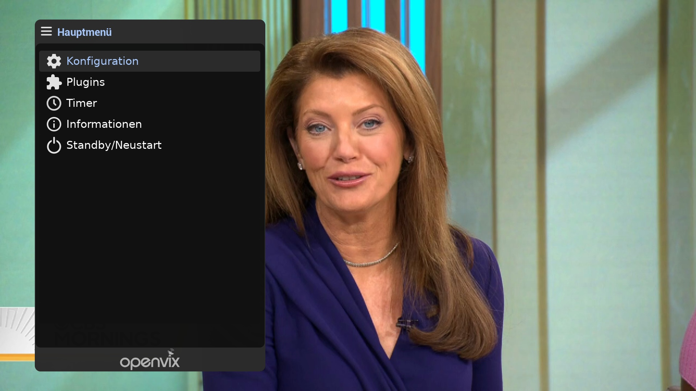
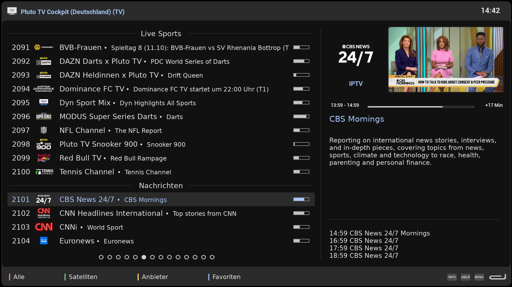
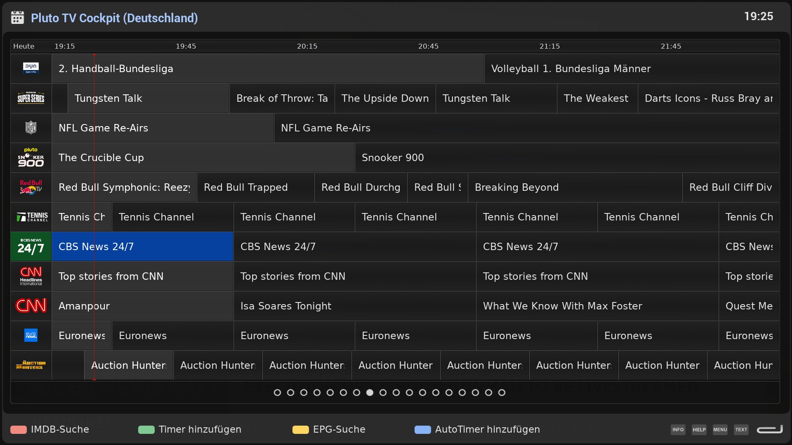

# Material Skin for Open Enigma2 settop boxes

A Material Design 3 skin in a dark theme, with a light variant.

- This skin is based on E2-DarkOS skin by DimitarCC.
- It was completely refactored by Claude Code AI to support [SkinForge](https://github.com/OpenCockpit/SkinForge)'s object oriented, hierarchical model using relative positioning of screenpart includes.
- The skin only supports OpenVix.

## Documentation

The colour concept (dark and light) and the recolouring of the artwork are described in the [MaterialSkinCockpit wiki](https://github.com/OpenCockpit/materialskincockpit/wiki).

## Installation
- https://OpenCockpit.github.io/MaterialSkinCockpit

## Wiki
- https://github.com/OpenCockpit/MaterialSkinCockpit/wiki
