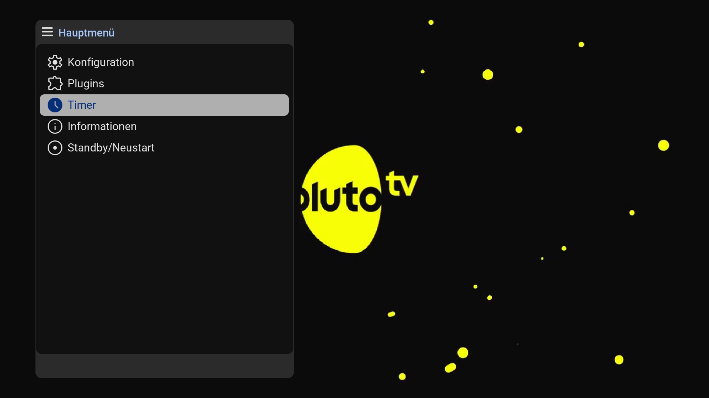
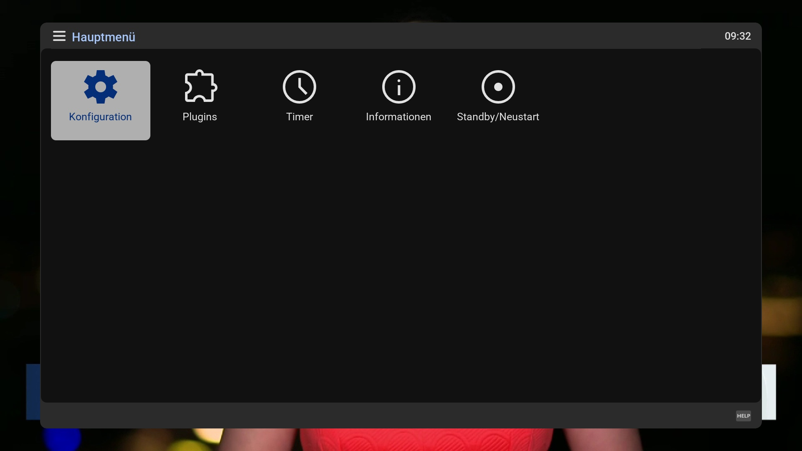
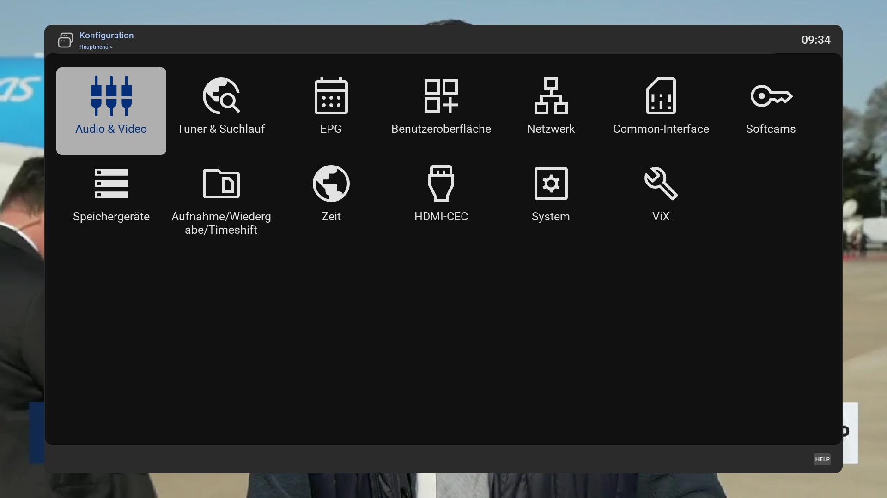
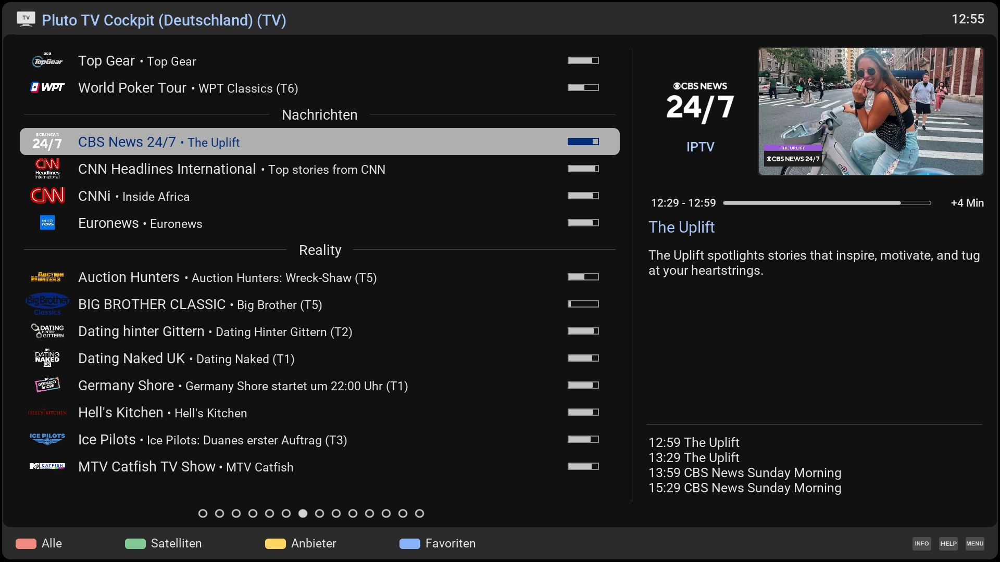
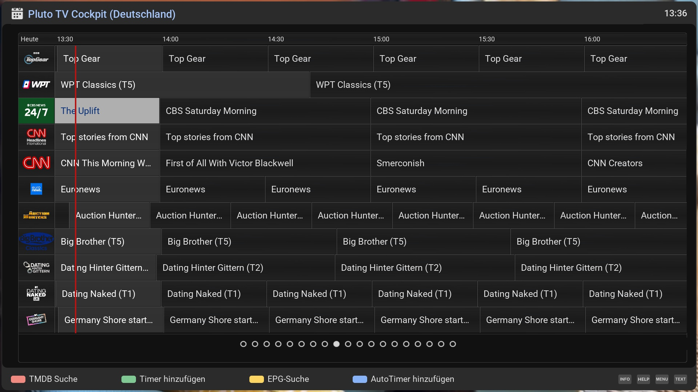

# Material Design Skin for Open Enigma2

- This skin was originally based on the E2-DarkOS skin by DimitarCC.
- It was completely refactored by Claude Code AI to support [SkinForge](https://github.com/OpenCockpit/SkinForge)'s object oriented, hierarchical model using relative positioning of screenpart includes.
- The skin features a grid menu structure with a new home screen that allows to specify links to bouquets, channels, menu items, and plugins used in day-to-day usage patters.
- The skin follows Google's Material Design 3 style, the menu icons are [Material Symbols](https://fonts.google.com/icons) (Apache 2.0).

## New Home

## Main Menu

## Main Menu Settings

## Channel selection

## Grid-EPG

## Limitations
- Only supports OpenViX

## Installation
- https://OpenCockpit.github.io/MaterialSkinCockpit

## Wiki
- https://github.com/OpenCockpit/MaterialSkinCockpit/wiki
